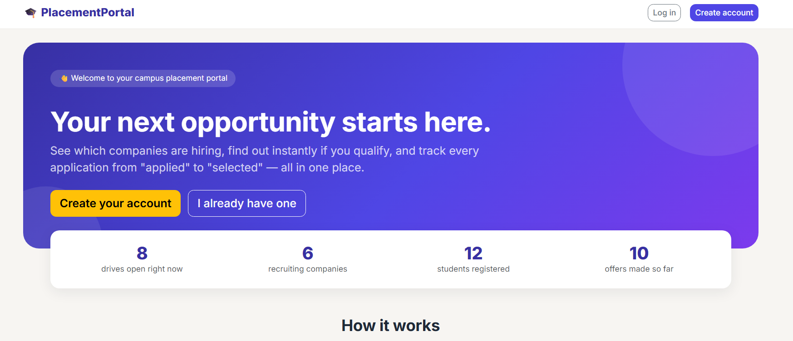
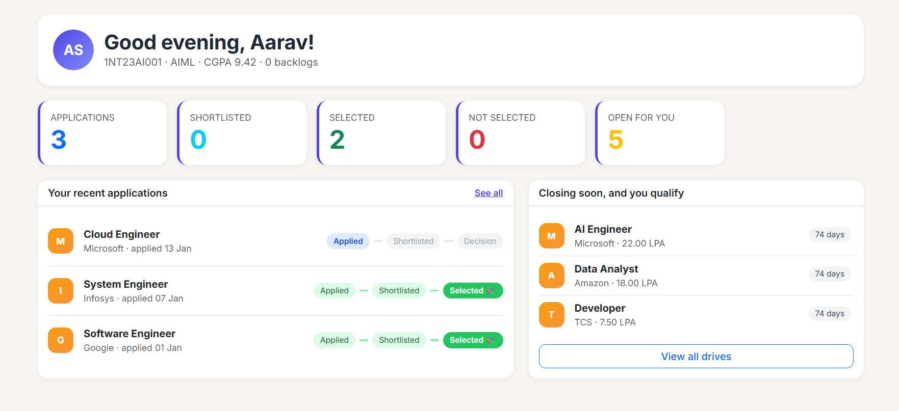
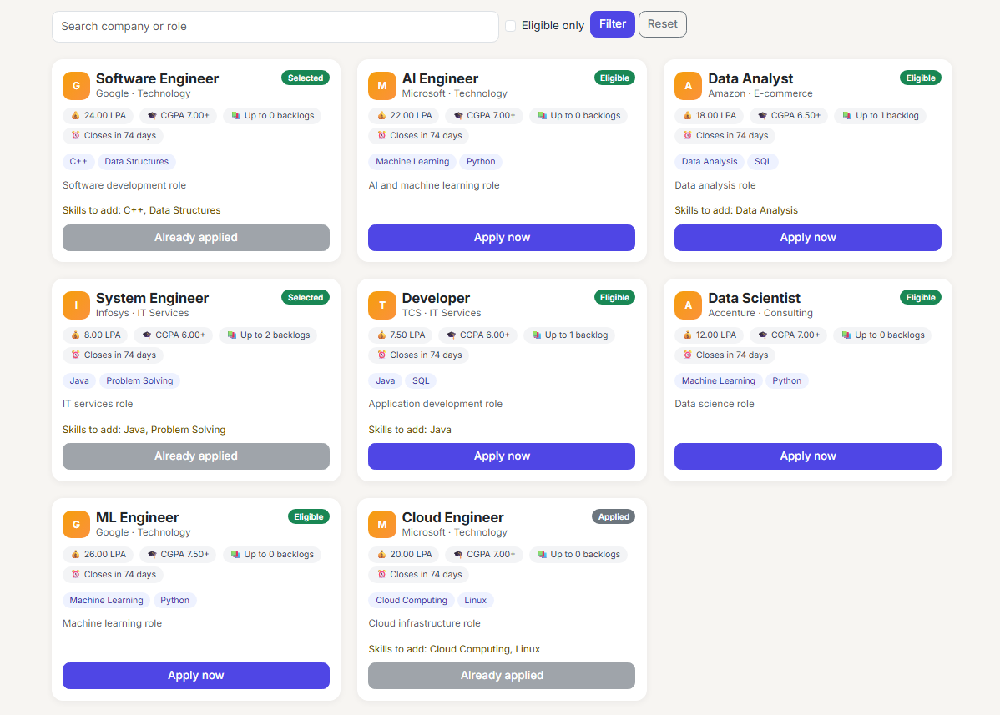
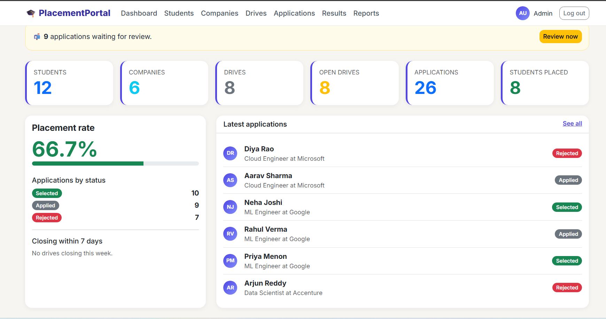
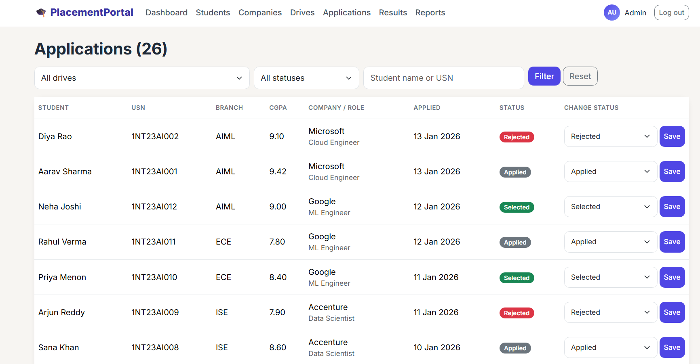

# College Placement Management System

A web-based College Placement Management System developed using Python Flask and MySQL to simplify and manage college placement activities through a centralized platform.

## Overview

The College Placement Management System is a web application designed to organize and simplify the college placement process. It provides a centralized platform where students can explore placement opportunities, apply for drives, and track their application status.

Administrators can manage placement drives, company information, and student applications. The application uses Flask for backend development and MySQL for relational database management.

This project demonstrates the practical application of Database Management System concepts, including relational tables, data relationships, SQL queries, and database-driven web development.

## Objectives

- To digitize the college placement process.
- To maintain student and company information in a centralized database.
- To provide students with access to placement drives.
- To enable students to apply for placement opportunities and track application statuses.
- To help administrators manage placement drives and applications.
- To apply DBMS concepts in a practical web application.

## Features

### Student Module

- Student registration and login
- Student dashboard
- View available placement drives
- Apply for placement opportunities
- Track application status
- Access placement-related information

### Admin Module

- Admin login and dashboard
- Manage placement drives
- View and manage student applications
- Manage company and placement information
- Monitor application statuses
- Access placement-related summaries

## Technologies Used

| Technology | Purpose |
|---|---|
| Python | Backend programming |
| Flask | Web application framework |
| MySQL | Relational database |
| HTML5 | Web page structure |
| CSS3 | Styling and layout |
| JavaScript | Client-side interactions |
| Bootstrap | Responsive UI, if used |
| Git | Version control |
| GitHub | Source code hosting |
| Visual Studio Code | Development environment |

## Project Structure

```text
college-placement-system/
│
├── app.py
├── config.py
├── requirements.txt
├── README.md
├── .env
├── .gitignore
│
├── routes/
│   ├── admin.py
│   ├── auth.py
│   └── student.py
│
├── templates/
│   ├── base.html
│   ├── index.html
│   ├── login.html
│   ├── register.html
│   ├── admin/
│   └── student/
│
├── static/
│   ├── css/
│   ├── js/
│   └── images/
│
├── sql/
│   ├── schema.sql
│   └── seed.sql
│
└── docs/
    └── images/
        ├── landing-page.png
        ├── student-dashboard.png
        ├── student-drives.png
        ├── admin-dashboard.png
        └── admin-applications.png
```

### 1. Landing Page

The landing page introduces the placement portal and provides access to the main features.



### 2. Student Dashboard

The student dashboard provides an overview of placement activities and application information.



### 3. Browse Placement Drives

Students can explore available placement opportunities and view drive information.



### 4. Admin Dashboard

The admin dashboard provides an overview of placement management activities.



### 5. Application Management

Administrators can review and manage student applications.




## Author

**Aditya Raushan**
**Department:** Artificial Intelligence and Machine Learning (AIML)  
**Institution:** Nitte Meenakshi Institute of Technology (NMIT), Bengaluru

